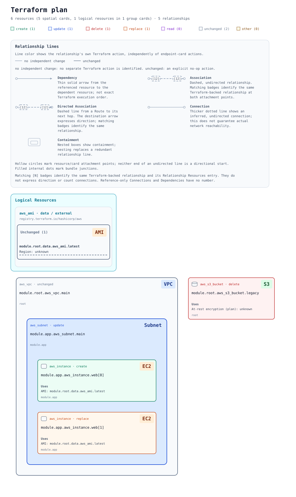

# planorama

Terraform plan JSON を、構成の参照関係・AWS の包含・接続が分かる SVG または自己完結型 HTML に変換する CLI です。HTML は検索・選択・ズームに対応し、生成後はオフラインで開けます。

単一 JSON または明示的な state 名を付けた複数 JSON から、アップロードせずに生成する [ブラウザ UI と Wasm API](docs/browser.md) も利用できます。CLI と同じ解析・選択・描画処理を Web Worker 内で実行します。



[基本 SVG](examples/diagram.svg) · [HTML ビューアー例](examples/viewer.html) · [大型 AWS 例](examples/multi-account/diagram.svg)

## 入手・導入

**公開済みリリースはまだありません。** 初回公開後は [GitHub Releases](https://github.com/ritz-p/planorama/releases) から、OS に合う archive と同じ release の `SHA256SUMS` を取得してください。現時点で試す場合は [開発者ガイド](CONTRIBUTING.md#開発環境) のソースビルドを使えます。

| OS / architecture | 配布ファイル名（`<VERSION>` は公開バージョン） |
| --- | --- |
| Linux x86_64（glibc 2.35 以上） | `planorama-v<VERSION>-x86_64-unknown-linux-gnu.tar.gz` |
| Windows x86_64（Windows 10 / Server 2022 以降向け） | `planorama-v<VERSION>-x86_64-pc-windows-msvc.tar.gz` |
| macOS 15 以上 / Apple Silicon | `planorama-v<VERSION>-aarch64-apple-darwin.tar.gz` |
| macOS 15 以上 / Intel | `planorama-v<VERSION>-x86_64-apple-darwin.tar.gz` |

[OS 別のダウンロード・SHA-256 確認・展開・起動手順](docs/releases.md#ダウンロードと実行) に従い、展開先で `./planorama --version`（Windows は `.\planorama.exe --version`）を確認します。Linux arm64・Alpine/musl・Windows arm64・32-bit は提供しません。チェックサムは破損確認用で、署名による真正性保証ではありません。

既存の plan JSON を描画するだけなら Rust・Docker・Terraform・Graphviz・Node.js は不要です。本体は [MIT OR Apache-2.0](LICENSE) です。依存ライブラリには各通知が適用されます。AWS 公式アイコンは同梱せず、サービス名で表示します。[旧設定からの移行](docs/icons.md)を参照してください。

## 最短の生成手順

Terraform を初期化済みの作業ディレクトリで、保存済み plan を JSON に変換します。以下は導入した `planorama` を `PATH` に追加した場合の例です。

```sh
terraform plan -out=tfplan
terraform show -json tfplan > plan.json
planorama plan.json -o diagram.svg
planorama plan.json --format html -o diagram.html
```

`diagram.svg` または `diagram.html` をブラウザで開きます。バイナリを `PATH` に追加しない場合は `planorama` を展開先の実行ファイルへのパスに置き換えてください。カレントディレクトリに置いた場合は Linux/macOS で `./planorama`、Windows で `.\planorama.exe` です。

Windows PowerShell 5.1 では、JSON 変換行を次に置き換えます。`cmd` のリダイレクトで Terraform の UTF-8 出力を直接保存し、PowerShell による文字列への変換を避けます。

```powershell
cmd /d /c "terraform show -json tfplan > plan.json"
if ($LASTEXITCODE -ne 0) { throw 'terraform show failed' }
```

既存の JSON があれば Terraform の2行は不要です。小規模な [サンプル入力](examples/plan.json) でも同じ生成コマンドを試せます。

## よく使う設定

```sh
planorama plan.json --changed-only -o changes.svg
planorama plan.json --icon-mode service-name -o services.svg
planorama plan.json --omit-relationship-legend -o without-legend.svg
planorama plan.json --coverage-report coverage.md -o diagram.svg
planorama plan.json --diagnostics -o diagram.svg
```

[絞り込み](docs/filtering.md)では module の選択や特定リソース周辺への focus、[凡例の設定](docs/relationships.md)では関係の説明の省略ができます。[複数 plan](docs/multi-plan.md) は `--state ID=PATH` を使います。全オプションは `planorama --help` で確認してください。

繰り返し使う設定は [TOML ファイル](docs/configuration.md)にまとめられます。[サンプル](examples/planorama.toml)を保存した場合:

```sh
planorama plan.json --config planorama.toml --preset review -o review.html
```

設定の優先順位は「既定値 → ファイル共通設定 → プリセット → 明示的 CLI 指定」です。設定ファイルの自動探索は行いません。

## 重要な制限

- 入力は `terraform show -json` の保存済み plan 形式です。`terraform plan -json` のイベントストリームや state JSON は対象外です。
- plan・JSON には機密値が含まれ得ます。実環境の plan/state をコミットしないでください。図にはリソース識別子と許可リストにある Organizations policy type の分類ラベルが残り、SVG の Route には検証済みの宛先定数を表示する場合があります。HTML では宛先定数を省略します。[入力と機密情報](docs/provider-evidence.md#privacy-and-validation)、[Route の表示範囲](docs/routes.md)を確認してください。
- JSON 単独では AWS account は unknown です。任意の `--provider-plan` は、同じ保存済み plan、作成時と同じ Terraform（検証済みは 1.9.8 / 1.16.6）、初期化済み hashicorp/aws 5.100.0 スキーマを必要とします。動的・未解決の構成は unknown のままです。[provider evidence の条件](docs/provider-evidence.md)を参照してください。
- JSON 読み込み、resource region override、provider evidence は検証済み範囲が異なります。[Terraform / AWS Provider 互換性 matrix](docs/terraform-compatibility.md)で実 plan の比較対象と制限を確認できます。
- 図は解決できた構成上の関係を表します。Terraform の厳密な実行順序やネットワーク到達性、交差・重なりのない最適配置は保証しません。未解決の理由は `--diagnostics` で確認できます。

## 詳細文書・開発

| 内容 | 文書 |
| --- | --- |
| 表示の読み方と AWS の対応範囲 | [関係線・凡例](docs/relationships.md)、[AWS の分類と包含](docs/aws.md)、[論理コンポーネント](docs/components.md)、[Route](docs/routes.md) |
| 操作・変更・検査結果 | [import・移動・置換・drift](docs/operations.md)、[Terraform checks](docs/checks.md) |
| 生成設定と選択 | [設定ファイル](docs/configuration.md)、[module 一覧・絞り込み](docs/filtering.md)、[複数 plan](docs/multi-plan.md)、[outputs](docs/outputs.md) |
| 入力の identity・account/region の根拠 | [Models](docs/models.md)、[provider evidence](docs/provider-evidence.md) |
| HTML と診断 | [ビューアー操作](docs/viewer.md)、[coverage report](docs/coverage.md)、[layout diagnostics](docs/layout-diagnostics.md) |
| リソース対応・アイコン・表示名・出典 | [生成された対応一覧](docs/resource-support.md)、[アイコン仕様](docs/icons.md) |
| 開発・設計・性能計測 | [CONTRIBUTING](CONTRIBUTING.md)、[Architecture](docs/architecture.md)、[Routing](docs/routing.md)、[Benchmarks](docs/benchmarks.md) |
| CI・配布 | [CI 運用](docs/ci.md)、[リリース手順](docs/releases.md) |
